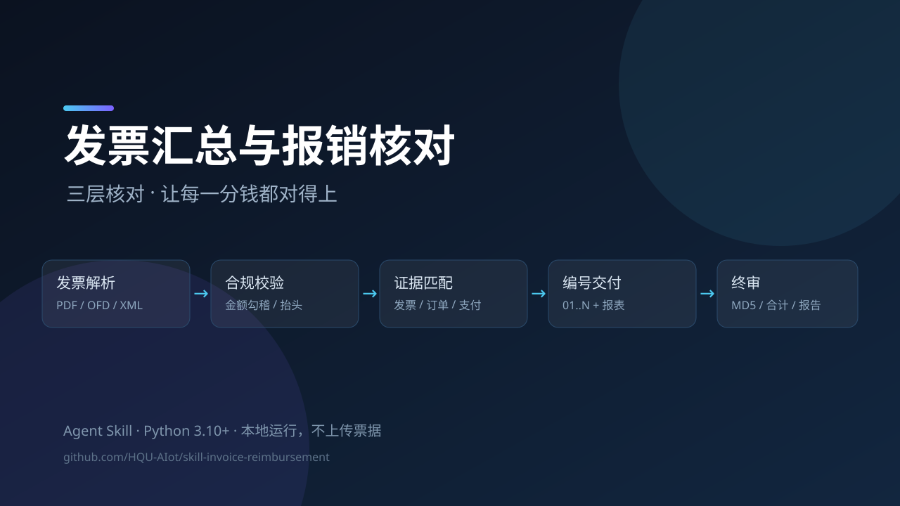
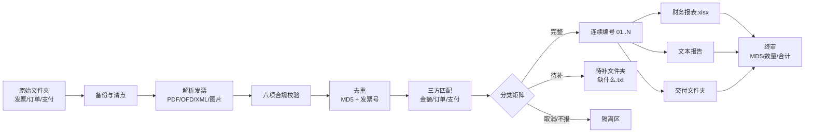

# 发票汇总与报销核对

> 把一堆电子发票、订单截图、支付截图，整理成可以直接交财务的报销包，并且每一分钱都能对上。




这是一个面向 **中文电子发票报销** 的 Agent Skill：把发票（PDF/OFD/XML/图片）、订单截图、支付截图混在一个文件夹里，交给它，它会完成解析、校验、去重、三方匹配、分类、连续编号、生成财务报表、生成交付文件夹和终审。

它不是“批量改名脚本”，核心是三层核对：

1. **发票本身是否合规**：号码、抬头、税号、金额勾稽、大小写一致。
2. **发票是否对得上真实订单和真实支付**：发票价税合计 = 订单实付 = 支付金额。
3. **最终交付的每一张发票，是否都有完整证据链**：发票 + 订单详情 + 支付凭证，缺一不可。

---

## AI 怎么调用这个 Skill（重点）

这个仓库不是一个双击运行的软件，而是一套 **Agent Skill**。调用链是：

```text
你说任务
  → 客户端用 SKILL.md 的 name / description 匹配意图
  → 加载 SKILL.md
  → Agent 按需读 references/
  → Agent 运行 scripts/
  → 交付财务报表、核对报告、交付文件夹
```

`agents/openai.yaml` 提供客户端界面信息（显示名、短描述、默认调用语）；`references/` 是细节；`scripts/` 是确定性工具。

### 方式一：自动触发（推荐）

直接用自然语言描述任务，`description` 里的触发词会命中：

- “帮我整理这个文件夹里的发票，算出能报多少钱。”
- “核对发票和实付金额，看看还缺哪些截图。”
- “这批发票有没有重复的？帮我重新编号。”
- “生成财务报表和报销交付文件夹。”
- “最后审查一次再交付。”

### 方式二：显式调用

| 客户端 | 写法 | 说明 |
|---|---|---|
| ZCode | `/invoice-reimbursement 整理 D:\...\发票汇总` | 斜杠命令使用 `SKILL.md` 的 `name` |
| Codex | `$invoice-reimbursement 整理 D:\...\发票汇总` | 对应 `agents/openai.yaml` 的默认提示 |
| Claude Code / 通用 Agent | `使用 invoice-reimbursement skill 整理 D:\...\发票汇总` | 自然语言点名；支持斜杠命令时也可用 `/invoice-reimbursement` |
| 纯 CLI | `python scripts/parse_invoice.py ...` | 不经过 Agent，见下文 |

> 调用名是 **`invoice-reimbursement`**，不是仓库名 `skill-invoice-reimbursement`。仓库名遵循组织 `skill-功能名称` 规范；技能名由 `SKILL.md` 的 `name` 决定。

### 方式三：直接跑脚本

不想用 Agent，或要在 CI/批处理里跑：

```bash
python scripts/parse_invoice.py 01_电子发票/*.pdf \
  --buyer-name "你的单位名称" \
  --buyer-tax-id "你的单位税号" \
  --json invoices.json

python scripts/dedupe.py --root .
python scripts/build_delivery.py --manifest manifest.json --out 报销交付_YYYYMMDD --workbook 财务报表.xlsx
python scripts/check_delivery.py --manifest manifest.json --delivery 报销交付_YYYYMMDD --workbook 财务报表.xlsx
```

### 最小调用示例

```text
使用 invoice-reimbursement 整理 D:\path\to\发票汇总。

购买方：<单位名称>；税号：<单位税号>。

要求：先备份；解析发票、校验金额/大小写/号码/抬头；按 MD5 和发票号去重；
把发票与订单、支付做三方匹配；只把证据链完整的项目入表，序号 01..N 连续；
缺材料的放待补文件夹并写“缺什么.txt”；生成财务报表、核对报告和报销交付_YYYYMMDD；
最后跑 check_delivery.py 终审，告诉我总张数、总金额、待补数量和终审结果。
```

Agent 加载后会自动读 `SKILL.md` 和相关 `references/`，按流程执行；遇到同金额多笔、订单取消、规格不一致等歧义会先问你，不会猜。

完整的调用链、客户端差异、按场景的 prompt 模板、没触发时怎么排查，见 **[docs/AI调用说明.md](docs/AI调用说明.md)**。

---

## 目录

- [AI 怎么调用这个 Skill](#ai-怎么调用这个-skill重点)
- [演示视频](#演示视频)
- [它解决什么问题](#它解决什么问题)
- [核心能力](#核心能力)
- [工作流](#工作流)
- [快速开始](#快速开始)
- [仓库结构](#仓库结构)
- [脚本](#脚本)
- [文档](#文档)
- [隐私与安全](#隐私与安全)
- [已知限制与路线图](#已知限制与路线图)
- [作者与维护状态](#作者与维护状态)
- [参与贡献](#参与贡献)
- [许可证](#许可证)

---

## 演示视频

> 录制后把文件放到 `docs/assets/demo.mp4`，封面放到 `docs/assets/cover.png`。分镜、旁白和脱敏清单见 [`docs/演示视频脚本.md`](docs/演示视频脚本.md)。

[](docs/assets/demo.mp4)

如果视频尚未上传，可以先看 [`docs/使用文档.md`](docs/使用文档.md) 的“5 分钟快速开始”。

---

## 它解决什么问题

报销最痛苦的不是贴发票，而是“这笔钱到底能不能报”：

- 发票金额和实付金额差几毛，可能是红包、优惠券、运费，不能直接报。
- 同一张发票下载了三次，文件名不同，重复入表。
- 有发票、有支付，但订单截图找不到，财务打回。
- 订单已取消，发票还在，报了就是错账。
- 交付文件夹里发票、详情、支付数量对不上，少的那张没人发现。
- 财务报表里塞满备注、待补表、说明行，财务只想要一张干净的明细。

这套流程把这些问题变成可检查的规则：**不合规的隔离、缺材料的待补、重复的查重、可报销的连续编号，最后逐字节终审。**

---

## 核心能力

| 能力 | 说明 |
|---|---|
| 多格式解析 | PDF 文本层、OFD（`easyofd` 转 PDF）、税务 XML、图片发票（视觉读取） |
| 两种版式兼容 | 常规版式 + “标签/数值分离”版式，用中文大写金额反查小写 |
| 六项硬校验 | 金额勾稽、大小写、发票号码、购方抬头/税号、日期、明细合计 |
| 双重去重 | 文件级 MD5 + 发票号级；重复件隔离，不删除 |
| 三方匹配 | 发票价税合计 = 订单实付 = 支付金额；数量/规格/状态逐项核对 |
| 分类矩阵 | 可报销 / 待补 / 已取消 / 不报销 / 额外支付，各有明确去向 |
| 连续编号 | 最终 `01..N` 无空号；两阶段重命名避免碰撞 |
| 极简报表 | 只保留已报销项目：序号、物品、用途、数量、价格 + 合计行 |
| 四份报告 | 核对报告、支付待补清单、截图齐全情况、新增放入说明 |
| 扁平交付夹 | `序号-物品-发票/详情/支付`，工作簿 MD5 与主档一致 |
| 终审脚本 | 数量、序号、MD5、PDF 金额、工作簿合计、交付副本一致性 |

---

## 工作流



设计原则：

- **不删除任何票据**：重复件、待补件、取消订单全部隔离保留。
- **发票总额 ≠ 可报销金额**：只有证据链完整的才进表。
- **manifest 是唯一数据源**：工作簿、报告、交付夹从它生成，不手工多改。
- **交付夹是生成物**：每次从主档重建，不手工改名。
- **先备份再动手**：第一次整理前完整复制一份。

---

## 快速开始

### 1. 安装 Skill

```bash
git clone https://github.com/HQU-AIot/skill-invoice-reimbursement.git
```

把仓库目录复制到你的 Agent 客户端 skills 目录（复制后重命名为 `invoice-reimbursement`，与 `SKILL.md` 的 `name` 一致）：

```bash
# ZCode / 通用 agent skills
cp -r skill-invoice-reimbursement ~/.agents/skills/invoice-reimbursement

# Claude Code 风格
cp -r skill-invoice-reimbursement ~/.claude/skills/invoice-reimbursement
```

也可以放在项目的 `.zcode/skills/` 或客户端支持的插件目录。具体以你的客户端为准；核心是保留 `SKILL.md`、`references/`、`scripts/` 的相对结构，`agents/openai.yaml` 可选。

安装后有三种调用方式：自动触发（自然语言）、显式调用（`/invoice-reimbursement` 或 `$invoice-reimbursement`）、直接跑脚本。完整说明和 prompt 模板见 **[docs/AI调用说明.md](docs/AI调用说明.md)**。

### 2. 安装 Python 依赖

```bash
python -m pip install -r requirements.txt
```

- 必装：`pdfplumber`、`openpyxl`
- 可选：`easyofd`（只有处理 `.ofd` 文件时需要）

要求 Python 3.10+（脚本使用了 `X | None` 类型语法）。

### 3. 准备目录

推荐结构：

```text
发票汇总/
├─ 01_电子发票/            # 已入表的正式发票
├─ 02_订单截图/
│  └─ 支付凭证/
├─ 03_新增待整理/          # 新文件先放这里
│  ├─ 电子发票/
│  ├─ 订单截图/
│  └─ 支付截图/
├─ 04_未报销发票_待补材料/
├─ 99_其他/                # 重复件、不报销、原始压缩包
└─ 财务报表.xlsx
```

### 4. 跑脚本

```bash
# 解析并校验发票
python scripts/parse_invoice.py 01_电子发票/*.pdf \
  --buyer-name "你的单位名称" \
  --buyer-tax-id "你的单位税号" \
  --json invoices.json

# 查重（只读）
python scripts/dedupe.py --root .

# 按 manifest 生成交付夹
python scripts/build_delivery.py \
  --manifest manifest.json \
  --out 报销交付_YYYYMMDD \
  --workbook 财务报表.xlsx

# 终审
python scripts/check_delivery.py \
  --manifest manifest.json \
  --delivery 报销交付_YYYYMMDD \
  --workbook 财务报表.xlsx \
  --buyer-name "你的单位名称" \
  --buyer-tax-id "你的单位税号"
```

`manifest.json` 的字段见 [`references/manifest-schema.md`](references/manifest-schema.md)，脱敏示例见 [`examples/manifest.example.json`](examples/manifest.example.json)。

### 5. 跑测试

```bash
python -m unittest discover -s tests -v
```

当前覆盖：中文大写金额、空支付路径、工作簿文本序号/合计列、详情数量不一致。

---

## 仓库结构

```text
skill-invoice-reimbursement/
├─ SKILL.md                     # Agent Skill 主文件（触发条件、流程、原则）
├─ agents/openai.yaml           # 客户端界面：显示名、短描述、默认调用语
├─ references/
│  ├─ workflow.md               # 10 阶段详细操作
│  ├─ verification.md           # 校验规则、版式、金额解析、分类矩阵
│  ├─ naming-and-folders.md     # 命名与目录规范
│  ├─ pitfalls.md               # 实际踩过的坑
│  └─ manifest-schema.md        # manifest 字段定义
├─ scripts/
│  ├─ parse_invoice.py          # 发票 PDF 解析 + 合规校验
│  ├─ dedupe.py                 # MD5 / 发票号查重
│  ├─ build_delivery.py         # 生成扁平交付夹
│  └─ check_delivery.py         # 终审
├─ tests/test_scripts.py        # 回归测试
├─ examples/manifest.example.json
├─ docs/
│  ├─ AI调用说明.md             # 重点：Agent 怎么发现、加载、调用
│  ├─ 技术文档.md
│  ├─ 使用文档.md
│  ├─ 演示视频脚本.md
│  ├─ 审查报告.md
│  └─ assets/                   # 封面、截图、演示视频
├─ requirements.txt
├─ CHANGELOG.md
└─ .gitignore
```

---

## 脚本

| 脚本 | 作用 | 是否只读 |
|---|---|---|
| `scripts/parse_invoice.py` | 解析发票 PDF，校验金额勾稽、大小写、号码位数、购方税号/名称，输出 JSON | 是 |
| `scripts/dedupe.py` | 按 MD5 和发票号查重；默认只报告，`--apply` 才移动 MD5 重复件 | 默认只读 |
| `scripts/build_delivery.py` | 按 manifest 复制发票/订单/支付/附件，生成扁平交付夹 | 写交付夹 |
| `scripts/check_delivery.py` | 终审：序号、三件套、MD5、PDF 金额、工作簿合计、交付副本一致性 | 是 |

退出码约定：

- `0`：全部通过
- `1`：有问题需要处理（解析需人工复核、构建缺文件、终审失败）
- `2`：参数错误（如输出目录已存在且未加 `--force`）

---

## 文档

| 文档 | 适合谁 | 内容 |
|---|---|---|
| [AI 调用说明](docs/AI调用说明.md) | 想让 Agent 用起来的人 | 调用链、自动触发、`/` 与 `$` 显式调用、按场景 prompt 模板、没触发怎么排查 |
| [技术文档](docs/技术文档.md) | 开发者 / 想改脚本的人 | 架构、数据模型、解析与校验算法、脚本 API、扩展指南、已知限制 |
| [使用文档](docs/使用文档.md) | 第一次用的人 / 财务同事 | 安装、10 步流程、常见场景、FAQ、交付前清单 |
| [演示视频脚本](docs/演示视频脚本.md) | 录制演示的人 | 分镜、旁白、命令、脱敏清单、上传文案 |
| [审查报告](docs/审查报告.md) | 维护者 / 贡献者 | 逐项审查结论、实测问题、修复记录、发布检查清单 |
| [SKILL.md](SKILL.md) | Agent | 触发条件、核心原则、标准流程 |
| [references/](references/) | Agent / 深入使用者 | 流程细节、校验规则、命名规范、坑、manifest |

---

## 隐私与安全

- **本地运行**：脚本只读写本地文件，不发起网络请求，不上传票据，不包含遥测。
- **不要提交真实票据**：根目录 `.gitignore` 已忽略发票、截图、报表、备份、交付夹和 `manifest.json`。
- **示例全部脱敏**：仓库中的单位名称、税号、发票号码、订单号、商家名称均为虚构。
- **演示视频前先脱敏**：模糊单位抬头、税号、发票号、订单号、姓名、电话、地址。
- **发布前自查**：

```bash
git grep -nE "发票号码|纳税人识别号|税号|订单号" -- . ':!docs' ':!references' || true
git log -p --all | grep -nE "纳税人识别号|发票号码|订单号" || true
```

如果你在真实项目中使用，建议把项目数据放在仓库之外，或使用独立的私有目录。

---

## 已知限制与路线图

当前脚本覆盖“解析、查重、构建、终审”；**工作簿和四份文本报告仍由 Agent 按规范生成**，没有独立的一键脚本。

已知限制：

- 图片型 PDF / 截图发票需要视觉读取，`parse_invoice.py` 只能报告“文本太少”。
- 发票版式千差万别，正则解析失败时应回退到视觉核对，不要直接判发票异常。
- `dedupe.py --apply` 只移动 MD5 完全相同的文件；同号不同文件的副本只报告，需人工隔离。
- 序号默认两位；`N ≥ 100` 时需要统一改为三位并同步修改脚本。
- 工作簿默认只读第一张工作表；需要“核对明细”表时请人工确认。
- `easyofd` 的转换件文字层可能把税号拆成空格，不能替代平台下载的正式 PDF。

路线图：

- [ ] `scripts/build_workbook.py`：按极简规范一键生成 `财务报表.xlsx`
- [ ] `scripts/build_reports.py`：从 manifest 生成四份文本报告
- [ ] `scripts/rename_seq.py`：manifest 驱动的安全重命名（dry-run）
- [ ] `dedupe.py --apply` 支持同号不同文件的保留规则
- [ ] 图片发票 OCR 回退
- [ ] GitHub Actions：Windows + Ubuntu 跑单元测试
- [ ] 英文 README / 英文示例

---

## 作者与维护状态

- 作者：`glong888`（HQU-AIoT）
- 维护状态：可用（usable）— 已完成基本测试，适合一般报销整理任务。
- 适用平台：Windows / macOS / Linux；Python 3.10+。
- 反馈：欢迎在 [Issues](https://github.com/HQU-AIot/skill-invoice-reimbursement/issues) 提交脱敏后的版式或平台样本。

---

## 参与贡献

欢迎提 Issue 或 PR，尤其是：

- 新的发票版式（请提供脱敏后的文本层，不要提供真实发票）
- 新的平台订单/支付截图字段
- 新的校验规则或分类场景
- 测试用例和边界数据

提交前请确认：

1. 没有真实票据、税号、订单号、姓名、地址。
2. `python -m unittest discover -s tests -v` 全部通过。
3. 新增/修改的文档与脚本行为一致。

---

## 许可证

本项目使用 [MIT License](LICENSE)。

如果这个项目对你有帮助，欢迎 Star。
