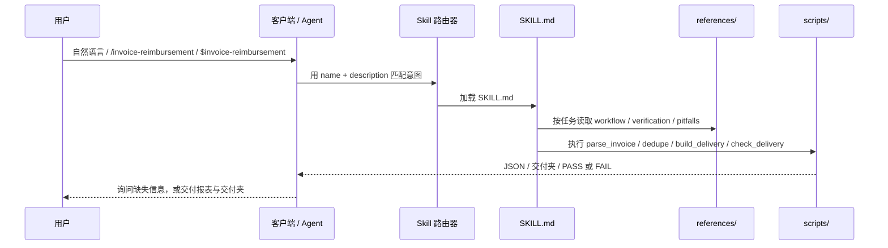

# AI 调用说明

这份文档只讲一件事：**Agent 怎么发现、加载、调用 `invoice-reimbursement`，以及你应该怎么开口。**

如果你只想看最短示例，跳到 [最小调用示例](#4-最小调用示例)。

---

## 1. 一句话理解

`invoice-reimbursement` 不是一个双击运行的 EXE，而是一套 **Agent Skill**：

- `SKILL.md` 告诉 Agent：什么时候该用、按什么原则做、按什么顺序做。
- `references/` 告诉 Agent：每一步的细节、校验规则、命名规范、常见坑。
- `scripts/` 是确定性的工具：解析、查重、构建交付夹、终审。
- `agents/openai.yaml` 是给客户端看的界面信息：显示名、短描述、默认调用语。

Agent 负责“理解任务、选择步骤、判断歧义、生成报表”；脚本负责“可重复、可测试的机械操作”。

---

## 2. 调用链



关键点：

1. **发现**：客户端读取 `SKILL.md` frontmatter 里的 `name: invoice-reimbursement` 和 `description`。
2. **匹配**：用户说“整理发票”“核对金额”“缺哪些支付截图”时，`description` 里的触发词命中。
3. **加载**：客户端把 `SKILL.md` 注入 Agent 上下文。
4. **按需读参考**：任务复杂时，Agent 再读 `references/workflow.md`、`verification.md` 等。
5. **调用工具**：Agent 运行 `scripts/*.py`，读取输出，继续下一步。
6. **交付**：Agent 生成工作簿、报告、交付夹，最后用 `check_delivery.py` 终审。

---

## 3. 三种调用方式

### 3.1 自动触发（推荐）

不需要记命令，直接用自然语言描述任务。以下说法都能命中 `description`：

- “帮我整理这个文件夹里的发票，算出能报多少钱。”
- “核对发票和实付金额，看看还缺哪些截图。”
- “这批发票有没有重复的？帮我重新编号。”
- “生成财务报表和报销交付文件夹。”
- “最后审查一次再交付。”

适用：日常使用。Agent 会自动加载 skill，按流程执行。

### 3.2 显式调用

如果自动触发不稳定，或者你想确保用的是这个 skill，直接点名：

| 客户端 | 写法 | 说明 |
|---|---|---|
| ZCode | `/invoice-reimbursement 整理 D:\...\发票汇总` | 斜杠命令使用 `SKILL.md` 的 `name` |
| Codex | `$invoice-reimbursement 整理 D:\...\发票汇总` | 对应 `agents/openai.yaml` 的 `default_prompt` |
| Claude Code / 通用 Agent | `使用 invoice-reimbursement skill 整理 D:\...\发票汇总` | 自然语言点名，客户端支持 Skill 时效果相同 |
| 支持 Skill 斜杠命令的其他客户端 | `/invoice-reimbursement ...` | 以客户端实际支持为准 |
| 纯 CLI | `python scripts/parse_invoice.py ...` | 不经过 Agent，见第 3.3 节 |

注意：

- **调用名是 `invoice-reimbursement`，不是仓库名 `skill-invoice-reimbursement`。** 仓库名遵循组织 `skill-功能名称` 规范；技能名由 `SKILL.md` 的 `name` 决定。
- 如果 `/invoice-reimbursement` 在你的客户端不可用，直接用“使用 invoice-reimbursement skill……”这种自然语言点名，通常也能加载。

### 3.3 直接跑脚本（不经过 AI）

不想用 Agent，或者要在 CI/批处理里跑，直接用 CLI：

```bash
python scripts/parse_invoice.py 01_电子发票/*.pdf \
  --buyer-name "你的单位名称" \
  --buyer-tax-id "你的单位税号" \
  --json invoices.json

python scripts/dedupe.py --root .
python scripts/build_delivery.py --manifest manifest.json --out 报销交付_YYYYMMDD --workbook 财务报表.xlsx
python scripts/check_delivery.py --manifest manifest.json --delivery 报销交付_YYYYMMDD --workbook 财务报表.xlsx
```

区别：

- Agent 会帮你**判断**分类、匹配、待补原因、报告措辞。
- CLI 只执行确定性操作；`manifest.json` 和工作簿仍需你自己准备。

---

## 4. 最小调用示例

把下面这段直接发给 Agent（路径、单位、税号换成你的）：

```text
使用 invoice-reimbursement 整理 D:\path\to\发票汇总。

购买方：<单位名称>；税号：<单位税号>。

要求：
1. 先完整备份原始目录。
2. 解析发票，校验金额勾稽、大小写、号码位数、购方抬头和税号。
3. 按 MD5 和发票号去重，重复件隔离，不删除。
4. 把每张发票和订单截图、支付截图做三方匹配；金额必须精确到分。
5. 只把“发票+订单+支付+金额/数量一致”的项目放进报销表，序号 01..N 连续。
6. 缺订单/支付/金额不一致的，放待补文件夹，每项写“缺什么.txt”。
7. 生成财务报表.xlsx、发票核对报告.txt、支付截图待补清单.txt、截图齐全情况.txt。
8. 生成报销交付_YYYYMMDD，并跑 check_delivery.py 终审。
9. 最后告诉我：总张数、总金额、待补数量、终审结果。
```

Agent 收到后大致会：

1. 读取 `SKILL.md`，确认流程和原则。
2. 读取 `references/workflow.md`、`verification.md`、`manifest-schema.md`。
3. 清点目录，判断哪些是发票、订单、支付。
4. 跑 `parse_invoice.py`，把需要人工复核的标出来。
5. 跑 `dedupe.py`，列出重复组。
6. 逐张匹配，遇到同金额多笔、订单已取消、规格不一致时向你确认。
7. 建立 `manifest.json`，生成工作簿和报告。
8. 跑 `build_delivery.py`，再跑 `check_delivery.py`。
9. 把结果、待补清单和终审输出交给你。

---

## 5. 按场景的 prompt 模板

### 5.1 第一次整理

```text
使用 invoice-reimbursement 第一次整理 D:\path\to\发票汇总。
购买方：<单位名称>；税号：<单位税号>。
先备份，再按“解析 → 校验 → 去重 → 匹配 → 分类 → 编号 → 报表 → 交付 → 终审”完整走一遍。
无法唯一匹配的订单/支付不要猜，列出来问我。
```

### 5.2 新增一批发票

```text
使用 invoice-reimbursement 处理 03_新增待整理 里的新发票。
当前已报销到序号 <N>，新项目从 <N+1> 开始，最终序号保持连续。
更新 manifest、财务报表、核对报告和报销交付_YYYYMMDD，最后终审。
```

### 5.3 只核对金额，不整理

```text
使用 invoice-reimbursement 只核对 D:\path\to\发票汇总 的金额和证据链，不生成交付夹。
购买方：<单位名称>；税号：<单位税号>。
输出：每张发票的发票号、价税合计、订单实付、支付金额、是否三方一致、缺什么。
```

### 5.4 查单张发票为什么没入表

```text
使用 invoice-reimbursement 检查发票号 <发票号> 为什么没有进报销表。
列出：发票金额、订单金额、支付金额、订单状态、缺哪些材料、该怎么补。
```

### 5.5 重新生成交付夹

```text
使用 invoice-reimbursement 从当前 manifest 重新生成报销交付_YYYYMMDD，
工作簿用主档最新版，生成后跑终审，确认 MD5、序号、三件套和合计。
```

### 5.6 处理 OFD / XML

```text
使用 invoice-reimbursement 处理 01_电子发票/OFD与XML 里的 OFD 和 XML。
OFD 转 PDF 只作为可视化副本，保留原件；XML 只生成“信息页”，不能冒充正式发票。
转换后核对发票号、金额、购方三项。
```

### 5.7 交付前最后审查

```text
使用 invoice-reimbursement 对 报销交付_YYYYMMDD 做最终审查。
逐项检查：工作簿序号/行数/合计、交付夹三件套、主档与交付件 MD5、逐张 PDF 的发票号和金额、待补项是否还在、备份是否完整。
有任何 ERROR 不要交付，先告诉我怎么修。
```

---

## 6. 调用时最好提供的信息

| 信息 | 为什么需要 | 示例 |
|---|---|---|
| 项目目录 | Agent 要清点和读写 | `D:\path\to\发票汇总` |
| 购买方名称、税号 | 校验发票抬头 | `示例单位` / `91110000XXXXXXXXXX` |
| 当前最大序号 | 新增批次从 N+1 开始 | `已到 39，新项目从 40 开始` |
| 报销口径 | 哪些不报、哪些按实付报 | `云服务费不报；红包差额按实付` |
| 是否生成交付夹 | 决定是否跑 `build_delivery` | `生成 报销交付_20261022` |
| 是否允许写操作 | `--apply` / `--force` 有副作用 | `允许移动重复件，不要覆盖已有交付夹` |
| 歧义处理偏好 | 同金额多笔怎么选 | `拿不准就列出来问我，不要猜` |

---

## 7. Agent 会做什么、不会做什么

### 会做

- 读取 `SKILL.md` 和按需读取 `references/`。
- 清点目录、解析发票、校验、去重、匹配、分类。
- 建立 `manifest.json`，生成工作簿、报告、交付夹。
- 跑 `check_delivery.py` 终审，报告 ERROR/WARN。
- 在信息不足时向你提问，而不是编造。

### 不会做

- 不会删除发票或截图；重复/待补/取消件只隔离。
- 不会上传票据、不发起网络请求、不包含遥测。
- 不会做发票真伪查验（不调用税务平台）。
- 不会在金额/订单/支付无法唯一匹配时“猜一个”。
- 不会在没有明确授权时执行 `--force`（删除输出目录）或 `--apply`（移动重复件）。

---

## 8. 权限与工具边界

Agent 要完成这套流程，需要：

- **文件读取**：扫描发票、订单、支付截图，读取 PDF/OFD/XML。
- **文件写入**：生成 `manifest.json`、`财务报表.xlsx`、报告、交付夹。
- **命令执行**：运行 `scripts/*.py`（Python 3.10+，`pdfplumber`、`openpyxl`，OFD 需要 `easyofd`）。
- **不需要网络**：脚本不访问外网；安装依赖时需要包源。

高风险操作：

- `dedupe.py --apply` 会移动重复文件到隔离目录。
- `build_delivery.py --force` 会先删除输出目录。
- 重命名会改动主档文件名。

调用时明确说“不要删除/不要覆盖/先备份”，Agent 应按你的授权边界执行。

---

## 9. 没触发怎么办

按顺序排查：

1. **确认安装位置**：`SKILL.md` 是否在客户端的 skills 目录下，且与 `references/`、`scripts/` 同级。
2. **显式点名**：直接说“使用 invoice-reimbursement skill 处理这个文件夹”。
3. **检查名称**：调用名是 `invoice-reimbursement`，不是仓库名 `skill-invoice-reimbursement`。
4. **检查客户端**：是否支持 Agent Skills / `SKILL.md`；不支持时只能直接跑脚本。
5. **检查描述**：`SKILL.md` 的 `description` 是否被截断或改写；触发词是否还在。
6. **手动加载**：把 `SKILL.md` 的内容贴给 Agent，或让它先读 `SKILL.md` 再执行。
7. **直接 CLI**：用第 3.3 节的命令，至少能完成解析、查重、构建、终审。

---

## 10. 客户端差异

| 客户端 | 自动触发 | 显式调用 | 备注 |
|---|---|---|---|
| ZCode | 支持 | `/invoice-reimbursement` | 斜杠命令使用 skill name |
| Codex | 支持 | `$invoice-reimbursement` | 读取 `agents/openai.yaml` 的默认提示 |
| Claude Code | 支持 | 自然语言点名；支持斜杠命令时可用 `/invoice-reimbursement` | 以实际版本为准 |
| Cursor / 其他 IDE Agent | 取决于是否支持 Agent Skills | 点名 skill 或直接读 `SKILL.md` | 不支持时用 CLI |
| 纯终端 | 不支持 | `python scripts/...` | 无 Agent 判断，只做机械操作 |

> 不同客户端的加载机制可能变化；核心是让 Agent 读到 `SKILL.md`。只要 `SKILL.md` 进入上下文，后续流程就能执行。

---

## 11. 一次完整对话长什么样

```text
用户：
使用 invoice-reimbursement 整理 D:\path\to\发票汇总。
购买方：示例单位；税号：91110000XXXXXXXXXX。
先备份，再解析、去重、匹配；只把证据链完整的入表；缺材料的放待补；
生成财务报表、核对报告和报销交付_YYYYMMDD；最后终审。

Agent：
已加载 invoice-reimbursement。先清点目录：发票 N 张、订单截图 M 张、支付截图 K 张。
发现 3 组需要确认：
1) 两笔同金额支付，订单号不同；
2) 一张发票金额比订单实付多 2.43 元；
3) 一张发票只有预览，没有有效发票号码。
要我按“金额不一致先待补、同金额按订单号区分”处理吗？

用户：
按这个口径处理；预览那张放待补，注明要正式 PDF。

Agent：
已完成：
- 可报销 N 张，合计 ¥X,XXX.XX；
- 待补 M 项，已写入 04_未报销发票_待补材料/，每项有 缺什么.txt；
- 财务报表.xlsx 已生成，序号 01..N 连续；
- 报销交付_YYYYMMDD 已生成，三件套齐全；
- check_delivery.py：PASS，无 ERROR；2 条 WARN（非 PDF 发票，需人工核对）。
详细见 发票核对报告.txt。
```

---

## 12. 相关文档

- [README](../README.md)
- [使用文档](使用文档.md)
- [技术文档](技术文档.md)
- [SKILL.md](../SKILL.md)
- [manifest 字段说明](../references/manifest-schema.md)
- [常见坑](../references/pitfalls.md)
