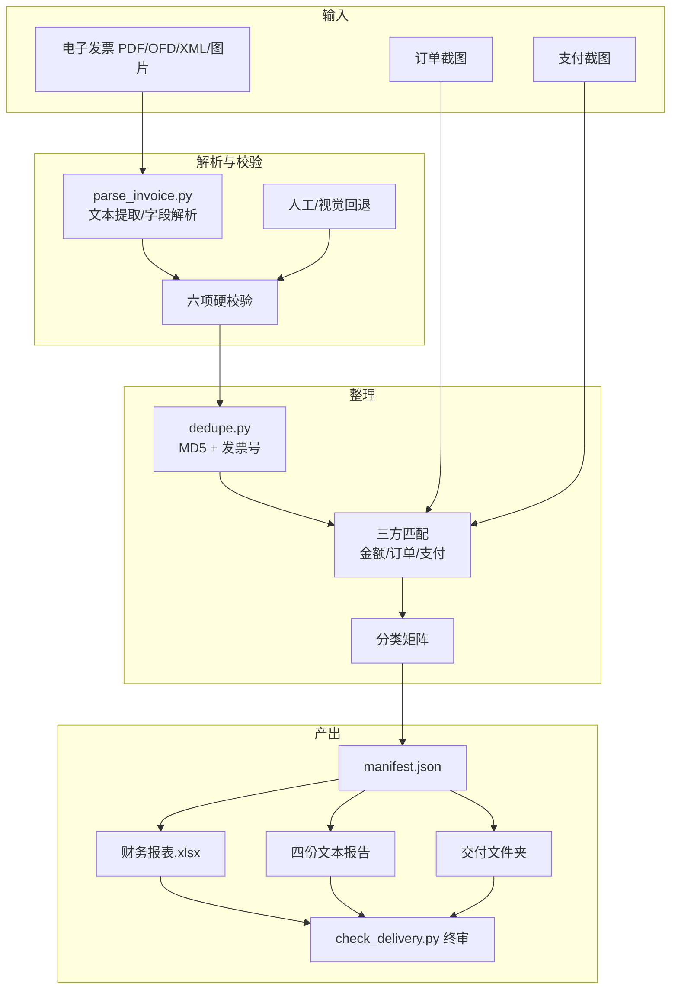

# 技术文档

本文面向想理解、修改或扩展这套流程的开发者。使用步骤见 [`使用文档.md`](使用文档.md)。

---

## 1. 文档定位

这套工具不是传统意义上的“发票 OCR 系统”，而是一个 **Agent Skill + 轻量 CLI**：

- `SKILL.md` 定义 Agent 在什么场景下加载、按什么原则和顺序工作。
- `references/` 是给 Agent 和开发者看的规则细节。
- `scripts/` 是确定性的、可测试的机械操作：解析、查重、构建交付夹、终审。
- 工作簿和文本报告由 Agent 按规范生成，因为它们的结构和措辞需要根据项目调整。

因此，技术上的关键不是“识别得多准”，而是 **把不可靠的识别结果放进一套可验证、可隔离、可审计的流程**。

---

## 2. 系统边界

### 2.1 做什么

- 解析中文电子发票：PDF 文本层、OFD、税务 XML、图片发票（视觉读取）。
- 校验发票要素与金额勾稽。
- 去重（MD5 + 发票号）。
- 把发票与订单截图、支付截图做三方匹配。
- 按分类矩阵决定“可报销 / 待补 / 已取消 / 不报销 / 额外支付”。
- 生成连续编号、极简财务报表、四份文本报告、扁平交付文件夹。
- 终审：数量、序号、MD5、PDF 金额、工作簿合计、交付副本一致性。

### 2.2 不做什么

- 不做发票真伪查验（不调用税务平台）。
- 不做 OCR 引擎训练；图片发票依赖调用方的视觉能力。
- 不做记账凭证、财务系统对接。
- 不自动联系商家重开发票。
- 不替用户决定“这张能不能报”；只给出证据链状态和待补原因。

### 2.3 运行环境

- Python 3.10+（脚本使用 `X | None` 类型语法）。
- 依赖：`pdfplumber`、`openpyxl`；OFD 可选 `easyofd`。
- 本地文件系统；脚本不发起网络请求。
- Windows / macOS / Linux 均可；文件名和编码按 Windows 兼容处理。

---

## 3. 设计原则

1. **不删除票据**：重复、待补、取消、不报销全部隔离保留。删除是不可逆的，隔离是可恢复的。
2. **证据链优先**：发票合规不等于可报销；必须同时有订单和支付，且金额一致。
3. **单一数据源**：`manifest.json` 是项目数据源；工作簿、报告、交付夹从它生成，避免多处手改。
4. **交付夹可重建**：交付夹是生成物，手工修改会在下次重建时丢失。
5. **序号最后统一排**：中途可用内部编号，交付前重排为 `01..N`，不留空号。
6. **先备份再动手**：第一次整理前完整复制原始目录。
7. **报表极简**：只保留已报销项目；核对过程放报告，不塞进工作簿。
8. **失败要显式**：缺文件、金额不符、解析失败都要变成可见的问题，而不是静默跳过。

---

## 4. 架构总览

### 4.1 流水线



### 4.2 模块职责

| 模块 | 输入 | 输出 | 确定性 |
|---|---|---|---|
| `parse_invoice.py` | 发票 PDF | 字段 JSON + checks | 是（正则/状态机） |
| 视觉读取 | 图片发票/扫描件 | 字段 JSON | 否（模型识别） |
| `dedupe.py` | 目录 | 重复组报告 | 是 |
| 匹配与分类 | 发票/订单/支付字段 | 状态 + 去向 | 半确定（规则 + 人工判断） |
| 工作簿生成 | manifest | `财务报表.xlsx` | 规范确定，生成方式可变 |
| 报告生成 | manifest + 核对结果 | 四份 txt | 规范确定，措辞可变 |
| `build_delivery.py` | manifest + 主档 | 交付夹 | 是 |
| `check_delivery.py` | manifest + 交付夹 + 工作簿 | PASS/FAIL | 是 |

---

## 5. 目录契约

### 5.1 推荐结构

```text
发票汇总/
├─ 财务报表.xlsx
├─ 发票核对报告.txt
├─ 支付截图待补清单.txt
├─ 截图齐全情况.txt
├─ 报销交付_YYYYMMDD/
├─ 01_电子发票/
│  └─ OFD与XML/
├─ 02_订单截图/
│  └─ 支付凭证/
├─ 03_新增待整理/
│  ├─ 电子发票/ 订单截图/ 支付截图/
│  ├─ 03_待确认/
│  ├─ 04_已取消订单/
│  └─ 放入说明.txt
├─ 04_未报销发票_待补材料/
│  ├─ 01_物品_金额/
│  └─ 说明.txt
├─ 98_技术资料_与报销无关/
├─ 99_其他/
│  ├─ 不报销/
│  ├─ 重复发票/
│  ├─ 重复截图/
│  ├─ 原始压缩包/
│  └─ 历史待办_已解决/
└─ _原始备份_YYYYMMDD/
```

### 5.2 不变量

| 不变量 | 含义 | 违反后果 |
|---|---|---|
| `01`、`02` 只放已入表材料 | 主档是唯一事实来源 | 交付夹可能包含未核对材料 |
| `03` 是入口 | 新文件先放三个子目录 | 文件散落，漏处理 |
| `04` 是待补隔离区 | 每项一个文件夹 + `缺什么.txt` | 待补原因丢失 |
| `99` 是隔离区 | 重复/不报/取消/压缩包 | 误把隔离件当主档 |
| 交付夹可整夹重建 | 不手工修改 | 下次重建丢失修改 |
| 序号连续 `01..N` | 与工作簿、文件名一致 | 财务对不上号 |
| 备份存在 | 第一次整理前完整复制 | 误操作无法恢复 |

### 5.3 备份命令

错误写法（目标在源目录内部）：

```bash
cd 发票汇总
cp -r . _原始备份_$(date +%Y%m%d)
# cp: cannot copy a directory, '.', into itself
```

正确写法（先复制到同级，再移入）：

```bash
cd ..
cp -r 发票汇总 "发票汇总_备份_tmp"
mv "发票汇总_备份_tmp" "发票汇总/_原始备份_$(date +%Y%m%d)"
```

---

## 6. 数据模型：manifest.json

### 6.1 为什么需要 manifest

如果工作簿、报告、交付夹各自维护一份数据，任何一次改金额或改序号都会产生不一致。manifest 把“项目事实”集中到一个 JSON：

- 工作簿从 `items` 生成。
- 交付夹从 `items` 的文件路径复制。
- 终审用 `items` 对照交付夹和工作簿。
- 待补、不报销单独放在 `pending`、`excluded`，不污染报销表。

### 6.2 顶层结构

```json
{
  "root": "D:/path/to/发票汇总",
  "buyer": {"name": "示例单位", "tax_id": "91110000XXXXXXXXXX"},
  "items": [],
  "pending": [],
  "excluded": [],
  "delivery": {"folder": "报销交付_YYYYMMDD", "workbook": "财务报表.xlsx"}
}
```

| 字段 | 必填 | 说明 |
|---|---|---|
| `root` | 否 | 项目根目录；不填则默认 manifest 所在目录 |
| `buyer.name` | 是 | 预期购方名称，用于校验 |
| `buyer.tax_id` | 是 | 预期购方税号 |
| `items` | 是 | 已报销项目 |
| `pending` | 否 | 待补项目 |
| `excluded` | 否 | 明确不报销项目 |
| `delivery` | 否 | 交付夹配置 |

### 6.3 items[]

```json
{
  "seq": 1,
  "short": "电子元件A",
  "item": "电子元件A 型号X1",
  "purpose": "样品测试",
  "qty": 1,
  "amount": 13.25,
  "invoice_no": "12345678901234567890",
  "invoice_date": "2026-01-15",
  "seller": "示例电子科技有限公司",
  "order_no": "1234567890123456789",
  "order_amount": 13.25,
  "invoice_file": "01_电子发票/01_电子元件A_13.25元_发票12345678901234567890.pdf",
  "order_files": ["02_订单截图/01_电子元件A_订单13.25元_1234567890123456789.png"],
  "payment_file": "02_订单截图/支付凭证/01_电子元件A_支付13.25元_1234567890123456789.jpg",
  "extra_files": [
    {"path": "01_电子发票/OFD与XML/01_电子元件A_发票.ofd", "suffix": "发票-OFD原件"}
  ],
  "status": "complete",
  "note": ""
}
```

| 字段 | 必填 | 说明 |
|---|---|---|
| `seq` | 是 | 最终连续序号，从 1 开始；只对 `status=complete` 的条目编号 |
| `short` | 是 | 文件名用短名 |
| `item` | 是 | 工作簿物品全名 |
| `purpose` | 是 | 用途分类 |
| `qty` | 是 | 数量 |
| `amount` | 是 | 发票价税合计 |
| `invoice_no` | 是 | 发票号码；数电票 20 位，老票 8/10/12 位 |
| `invoice_date` | 是 | 开票日期 `YYYY-MM-DD` |
| `seller` | 是 | 销售方 |
| `order_no` | 否 | 订单号；无订单填 `""` |
| `order_amount` | 否 | 订单实付；无订单填 `null` |
| `invoice_file` | 是 | 主档发票路径（相对 `root`） |
| `order_files` | 是 | 订单截图路径数组，至少 1 个 |
| `payment_file` | 是 | 支付截图路径；`complete` 项必须非空且是文件 |
| `extra_files` | 否 | 额外附件：OFD 原件、转换件、XML 信息页等 |
| `status` | 是 | `complete` 才进报销表；其他状态不参与构建 |
| `note` | 否 | 备注 |

### 6.4 状态枚举

| 状态 | 含义 | 去向 |
|---|---|---|
| `complete` | 发票 + 订单 + 支付 + 金额一致 + 数量/规格一致 | 报销表 |
| `amount_mismatch` | 发票金额 ≠ 实付 | 待补（重开/财务确认） |
| `spec_mismatch` | 规格/数量/品名不一致 | 待补（确认/重开） |
| `no_order` | 缺订单 | 待补 |
| `no_payment` | 缺支付 | 待补 |
| `no_proof` | 订单和支付都缺 | 待补 |
| `invalid_invoice` | 预览/缺税号/抬头错 | 待补（重开） |
| `canceled` | 订单已取消 | `04_已取消订单` |
| `excluded` | 用户明确不报 | `99_其他/不报销` |
| `extra_payment` | 无对应发票的支付 | `03_待确认` |

### 6.5 约束

- `seq` 唯一、连续、从 1 开始。
- `amount > 0`。
- `complete` 时 `order_amount == amount`。
- 所有路径存在且是文件，不是目录。
- `invoice_no` 位数符合票种，同批唯一。
- 修改 manifest 后重新构建交付夹，不手工改交付夹。

---

## 7. 解析子系统

### 7.1 PDF 文本提取

```python
import pdfplumber

with pdfplumber.open(path) as doc:
    text = "\n".join((page.extract_text() or "") for page in doc.pages)
```

`parse_invoice.py` 在提取后做一次空格压缩：

```python
flat = re.sub(r"[ \t]+", " ", text)
```

注意：压缩只处理空格和制表符，保留换行；正则里的 `\s` 仍可跨行匹配。

### 7.2 两种常见版式

**版式 A：常规**

```text
合 计 ¥11.73 ¥1.52
价税合计（大写） 壹拾叁圆贰角伍分 （小写）¥13.25
```

提取逻辑：

1. 用正则匹配 `价税合计` + `(大写)` + 中文大写金额 + `(小写)` + 数字。
2. 中文大写金额作为 `total_cn`，小写作为 `total`。
3. `合计` 行提取金额和税额。

**版式 B：标签与数值分离**

```text
合 计
价税合计（大写） （小写）
...
¥29.16 ¥3.79
叁拾贰圆玖角伍分 ¥32.95
```

提取逻辑：

1. 提取页面中所有长度 ≥ 4 的中文大写金额候选。
2. 逐个用 `cn_to_number()` 转成数字。
3. 在页面所有 `¥xx.xx` 中找与转换值相等（误差 < 0.005）的一个。
4. 找到则返回该值；否则返回 `(None, 第一个候选)`，交给人工/视觉核对。

代码中的正则：

```python
# 版式 A
r"价税合计\s*[（(]\s*大写\s*[)）]\s*([零壹贰叁肆伍陆柒捌玖拾佰仟万亿圆元角分整]{2,})"
r".{0,80}?[（(]\s*小写\s*[)）]\s*[¥￥]?\s*([0-9]+(?:\.[0-9]+)?)"

# 版式 B 候选
r"[零壹贰叁肆伍陆柒捌玖拾佰仟万亿圆元角分整]{4,}"
```

`{0,80}?` 是必要的：版式 B 中大写和小写标签之间可能夹着换行和别的文本。

### 7.3 中文大写金额状态机

实现位于 `scripts/parse_invoice.py::cn_to_number`。

```python
def cn_to_number(s: str) -> float:
    total = 0.0      # 已结算的 万/亿 部分
    section = 0.0    # 当前小节
    number = 0.0
    for ch in s:
        if ch in DIGITS:
            number = DIGITS[ch]
        elif ch in UNITS:
            if number == 0:
                number = 1
            section += number * UNITS[ch]
            number = 0
        elif ch in BIG:
            section = (section + number) * BIG[ch]
            total += section
            section = 0
            number = 0
        elif ch in "圆元":
            total += section + number
            section = 0
            number = 0
        elif ch == "角":
            total += number * 0.1
            number = 0
        elif ch == "分":
            total += number * 0.01
            number = 0
        elif ch == "整":
            pass
    return round(total + section + number, 2)
```

关键点：

- `UNITS` 是十/百/千；遇到单位时，如果 `number == 0`，按 1 处理（如“壹拾”=10）。
- `BIG` 是万/亿；遇到万/亿时，把当前小节结算并乘以进位，累加到 `total`。
- “圆/元”把整数部分落账；“角/分”直接按 0.1/0.01 累加。
- “整”忽略。
- 最后 `round(..., 2)`，避免浮点误差。

测试用例：

```python
assert cn_to_number("壹拾柒圆玖角") == 17.90
assert cn_to_number("叁拾贰圆玖角伍分") == 32.95
assert cn_to_number("壹佰肆拾壹圆贰角肆分") == 141.24
assert cn_to_number("壹万贰仟叁佰肆拾伍圆陆角柒分") == 12345.67
assert cn_to_number("壹亿贰仟万圆整") == 120000000.0
```

限制：

- 不处理“负号”“人民币”等前缀；票面一般不会出现。
- 不处理“零”在中间的特殊读法（如“壹仟零伍圆”），但逐字状态机仍能得到正确结果。
- 对异常字符串返回 `0.0` 或部分值；调用方应校验 `> 0`。

### 7.4 字段提取与回退

| 字段 | 主正则/方法 | 回退 |
|---|---|---|
| 发票号码 | `发票号码\s*[：:]\s*(\d{8,20})` | 独立行 8/10/12/20 位数字 |
| 开票日期 | `开票日期\s*[：:]\s*YYYY年M月D日` | 独立行 `YYYY年M月D日` |
| 价税合计 | 版式 A 正则 | 中文大写反查 ¥ 金额 |
| 金额/税额 | `合\s*计\s*[¥￥]\s*a\s*[¥￥]\s*b` | 在页面 ¥ 金额中找一对满足 `a + b = total` |
| 购方/销方 | 所有 `名称\s*[：:]\s*(...)`，第一个买方、第二个卖方 | 传入 `--buyer-name` 时优先用预期值；卖方取第一个非买方名称 |
| 购方税号 | 所有 15–20 位大写字母/数字 token，排除发票号码 | 传入 `--buyer-tax-id` 且出现在票面时直接采用预期值 |

注意：

- 金额/税额回退返回 `max(a,b)` 作为金额、`min(a,b)` 作为税额。正常发票金额大于税额；极端情况下可能颠倒，需要人工核对。
- 购方/销方名称的正则假设第一个“名称：”是购买方。少数版式可能先列销售方，脚本会误标；校验时以“预期购方名称是否出现在票面”为准，不依赖字段顺序。
- 税号回退取第一个 token，可能取到销售方税号；只要传入预期税号，校验仍能正确判断“预期税号是否出现”。报告中的 `buyer_tax_id` 字段应结合 `buyer` 一起看。

### 7.5 OFD

```bash
python -m pip install easyofd
```

```python
from easyofd import OFD

ofd = OFD()
ofd.read("发票.ofd", fmt="path")   # 必须指定 fmt="path"
pdf_bytes = ofd.to_pdf()
open("发票_OFD转PDF.pdf", "wb").write(pdf_bytes)
```

要点：

- `read()` 默认按 base64 处理；传路径不加 `fmt="path"` 会报 `UnicodeEncodeError` / base64 错误。
- 转换件的文字层可能把税号数字拆成空格（`1 2 1 0...`），不适合做机读主件。
- OFD 原件保留在 `01_电子发票/OFD与XML/`；转换件只作为可视化副本，命名必须带 `OFD转换件`，不能伪装成正式发票。
- 转换后人工核对发票号、金额、购方名称三项。

### 7.6 XML

税务 XML 是结构化数据，不是发票版面。常用字段：

```xml
<EInvoice>
  <EInvoiceData>
    <SellerInformation>
      <SellerName>...</SellerName>
      <SellerIdNum>...</SellerIdNum>
    </SellerInformation>
    <BuyerInformation>
      <BuyerName>...</BuyerName>
      <BuyerIdNum>...</BuyerIdNum>
    </BuyerInformation>
    <BasicInformation>
      <TotalAmWithoutTax>124.99</TotalAmWithoutTax>
      <TotalTaxAm>16.25</TotalTaxAm>
      <TotalTax-includedAmount>141.24</TotalTax-includedAmount>
      <TotalTax-includedAmountInChinese>壹佰肆拾壹圆贰角肆分</TotalTax-includedAmountInChinese>
    </BasicInformation>
    <IssuItemInformation>...</IssuItemInformation>
  </EInvoiceData>
</EInvoice>
```

XML 转 PDF 只能生成“信息页”，必须标注“非发票原件”，不能替代正式发票。信息页命名建议 `-XML信息页.pdf`。

### 7.7 图片发票

图片发票（PNG/JPG/扫描件）没有文本层，`pdfplumber` 提取不到内容。`parse_invoice.py` 会用 `has_text` 检查（文本长度 > 50）标记出来，交给视觉读取。

视觉读取必须逐项记录：

- 发票号码（位数是否符合票种）
- 开票日期
- 购买方名称 + 税号（税号栏是否为空）
- 销售方
- 项目名称、数量、单价
- 金额、税额、价税合计
- 发票类型（普票/专票）
- 备注/订单号

常见陷阱：

- 暗色模式，金额小数位容易看错。
- 票面写“发票号码：以实物为准” → 只是预览。
- 购方只写单位名称、税号栏空白 → 不合规。
- 截图被裁剪，税额或合计缺失。

### 7.8 输出 JSON

`parse_invoice.py` 输出：

```json
{
  "count": 1,
  "results": [
    {
      "file": "01_电子发票/01_电子元件A_13.25元_发票12345678901234567890.pdf",
      "invoice_no": "12345678901234567890",
      "date": "2026-01-15",
      "buyer": "示例单位",
      "buyer_tax_id": "91110000XXXXXXXXXX",
      "seller": "示例电子科技有限公司",
      "amount": 11.73,
      "tax": 1.52,
      "total": 13.25,
      "total_cn": "壹拾叁圆贰角伍分",
      "checks": {
        "arithmetic": true,
        "uppercase": true,
        "invoice_no_format": true,
        "buyer_tax_id": true,
        "has_text": true,
        "buyer_name": true
      },
      "needs_manual_review": false,
      "text_chars": 312
    }
  ]
}
```

- `checks` 的键会随参数变化：传 `--buyer-name` 时才有 `buyer_name`。
- `needs_manual_review = not all(checks.values())`。
- 任意一张需要复核，进程退出码为 1；全部通过为 0。
- 单张解析异常时，`results` 中会出现 `{"file": ..., "error": ..., "needs_manual_review": true}`。

---

## 8. 校验子系统

### 8.1 六项硬校验

| # | 检查 | 通过条件 | 自动化 |
|---|---|---|---|
| 1 | 金额勾稽 | `金额 + 税额 = 价税合计`，误差 ≤ 0.005 | `arithmetic` |
| 2 | 大写金额 | 中文大写换算值 = 小写价税合计 | `uppercase` |
| 3 | 发票号码 | 数电票 20 位；老票 8/10/12 位 | `invoice_no_format` |
| 4 | 购买方 | 名称 = 预期名称；税号 = 预期税号 | `buyer_tax_id` + `buyer_name` |
| 5 | 日期 | 开票日期与业务时间关系合理 | 人工/报告说明 |
| 6 | 明细 | 各行金额/税额之和 = 合计 | 人工/视觉 |

`parse_invoice.py` 只自动完成 1–4 中可机读的部分；5、6 必须人工核对。不要因为脚本返回 `needs_manual_review=false` 就认为发票一定合规。

### 8.2 容差

金额比较统一使用 `0.005`：

```python
abs(a + b - total) < 0.005
abs(cn_to_number(total_cn) - total) < 0.005
```

原因：金额是两位小数，浮点运算和四舍五入会带来 0.001 级误差；0.005 是“半分”边界，能容忍浮点误差但不会放过真正的分差。

### 8.3 分类矩阵

| 发票 | 订单 | 支付 | 金额 | 规格/数量 | 结论 |
|---|---|---|---|---|---|
| 合规 | 有 | 有 | 一致 | 一致 | 可报销 |
| 合规 | 有 | 有 | 一致 | 不一致 | 待补/确认 |
| 合规 | 有 | 有 | 不一致 | 一致 | 待补/重开 |
| 合规 | 有 | 无 | — | — | 待补支付 |
| 合规 | 无 | 有 | 支付=发票 | — | 待补订单 |
| 合规 | 无 | 无 | — | — | 待补订单+支付 |
| 预览/缺税号 | — | — | — | — | 不合规，重开 |
| 合规 | 已取消 | — | — | — | 不报销 |
| 用户明确不报 | — | — | — | — | 不报销 |

分类结果必须落到具体目录，并在 `缺什么.txt` 里写清“是什么、已有、缺什么、怎么补”。

---

## 9. 去重子系统

### 9.1 两种重复

| 类型 | 判定 | 处理 |
|---|---|---|
| 文件级 | MD5 完全相同 | 保留一份，其余移到 `99_其他/重复发票` 或 `重复截图` |
| 发票号级 | 不同文件但发票号相同 | 报告出来，人工决定保留哪份；通常保留 `01_电子发票/` 下的正式 PDF |

### 9.2 扫描范围

`dedupe.py` 只扫描以下后缀：

```python
SUFFIXES = {".pdf", ".ofd", ".xml", ".jpg", ".jpeg", ".png"}
```

跳过：

```python
SKIP_DIRS = ("_原始备份", "报销交付", "99_其他/重复", "历史待办", "OFD与XML")
```

跳过 `OFD与XML` 是为了避免把“OFD 原件 + 转换件”当成重复发票。跳过备份和交付夹是为了避免重复报告。

### 9.3 MD5 计算

按 1 MB 分块读取，避免大文件占内存：

```python
def md5(path: Path) -> str:
    h = hashlib.md5()
    with open(path, "rb") as f:
        for chunk in iter(lambda: f.read(1 << 20), b""):
            h.update(chunk)
    return h.hexdigest()
```

### 9.4 `--apply` 的语义

- 默认只读，输出重复组。
- `--apply` 必须同时给 `--quarantine-dir`，否则返回 2。
- 只移动 **MD5 重复组** 中除第一份以外的文件；文件名加 `重复_` 前缀；目标重名时自动加 `_2`、`_3`。
- **同号不同文件的副本不会自动移动**，只在输出中提示。这是有意保守：不同字节可能包含不同版式或附加信息，自动移动有风险。
- 移动后要重新校验 manifest 路径；如果 manifest 指向被移动的副本，需要改回主档路径。

### 9.5 保留哪一份

代码按排序后的路径保留第一份：

- `01_电子发票/...` 通常排在 `03_新增待整理/...` 和 `99_其他/...` 前面。
- 但如果主档缺失、只有待整理目录有副本，保留的可能是待整理副本。处理完新文件后应把主档补齐，再跑一次查重。

---

## 10. 匹配子系统

### 10.1 证据链

一张可报销发票必须有：

```text
发票（合规） ──金额一致── 订单（真实、未取消） ──金额一致── 支付（成功、未退款）
```

任何一环缺失或金额不等，都不能进“完全报销”表。

### 10.2 匹配顺序

1. **发票备注里的订单号/商家单号**：最可靠，直接定位订单。
2. **金额 + 日期**：在订单截图中找实付金额相同、日期相近的订单。
3. **金额 + 日期 + 收款方**：在支付截图中找对应交易。
4. **订单号/交易单号**：同金额多笔时用于排除。

### 10.3 金额规则

- 发票价税合计 = 订单实付 = 支付金额，精确到分。
- 订单实付不是商品原价：扣除优惠券、红包、淘金币、满减、运费。
- 支付金额是实际扣款，不是订单原价。
- 一张订单多张发票：发票合计 = 订单实付。
- 多张订单一张发票：订单实付合计 = 发票金额（需在报告中说明）。

### 10.4 数量/规格规则

- 逐项对比，不能只看总额。
- 数量不一致 → 待补/确认。
- 单位不同（套 vs 个）且金额一致 → 可备注说明。
- 规格不一致（如 `v1 10 片` vs `2.0 5 片`）→ 必须确认或重开。
- 品名不一致 → 确认是否同一商品；不能默认“差不多”。

### 10.5 状态规则

- 订单“已取消/已退款” → 不报销。
- 支付“已退款” → 不报销。
- 支付“支付成功”但无订单 → `03_待确认`。
- 同金额可能同时存在取消单和有效单，必须按订单号区分。
- 同一天、同一金额的两笔支付不一定是同一笔，必须比对订单号/交易单号/收款方/时间。

### 10.6 歧义处理

当无法唯一匹配时：

- 不要猜。
- 把候选订单/支付列在报告里。
- 状态设为待补或待确认，写清“为什么无法匹配”。
- 让用户提供订单详情或支付详情。

---

## 11. 编号与命名

### 11.1 主档命名

```text
发票：{seq:02d}_{short}_{amount:.2f}元_发票{invoice_no}.pdf
订单：{seq:02d}_{short}_订单{order_amount:.2f}元_{order_no}{ext}
支付：{seq:02d}_{short}_支付{pay_amount:.2f}元_{order_no or date}.jpg
```

示例：

```text
01_电子元件A_13.25元_发票12345678901234567890.pdf
01_电子元件A_订单13.25元_1234567890123456789.png
01_电子元件A_支付13.25元_1234567890123456789.jpg
```

规则：

- `seq` 两位，最终连续 `01..N`；`N ≥ 100` 时统一三位。
- `short` 简短、稳定、文件系统安全；同一物品多次购买加 A/B/C。
- 金额两位小数。
- 订单号完整保留；文件名总长 ≤ 120 字符。
- 同一订单多张截图：主图标准名，补充图加 `_明细`、`_2`。
- 已取消/已退款订单不进主档，放 `04_已取消订单`。

### 11.2 两阶段重命名

直接 `05 → 04` 可能覆盖已存在的 `04`。正确做法是先全部改成临时名，再改成目标名：

```python
tmp = []
for old, new in mapping.items():
    for p in root.glob(f"{old:02d}_*"):
        t = p.with_name("TMPRENAME_" + p.name)
        p.rename(t)
        tmp.append((t, new, p.name))

for t, new, old_name in tmp:
    rest = old_name.split("_", 1)[1]
    t.rename(t.with_name(f"{new:02d}_{rest}"))
```

限制：

- 示例按两位序号切片；`seq >= 100` 会截断，需要改成三位并同步修改切片。
- 重命名后要同步 manifest 中的所有路径，不要只改文件名。

### 11.3 交付夹命名

```text
{seq:02d}-{short}-发票{ext}
{seq:02d}-{short}-详情{ext}
{seq:02d}-{short}-详情2{ext}
{seq:02d}-{short}-支付{ext}
{seq:02d}-{short}-{extra_suffix}{ext}
```

- 序号与工作簿一致。
- 默认一个物品 3 个文件；多张订单截图用 `-详情2`、`-详情3`。
- 保留原扩展名，不强制转换。
- 转换件必须能从后缀看出是转换件（`-发票-OFD转换件`、`-XML信息页`）。

---

## 12. 报表与交付

### 12.1 财务报表规范

默认只输出一张 `报销明细`：

- 五列：序号、物品、用途、数量、价格。
- 只放 `status=complete` 的项目。
- 序号 `01..N` 连续。
- 最后一行合计：`合计 | N 张 | 金额`。
- 不加备注列、说明行、待补表、脚注。
- 金额格式 `¥#,##0.00`；表头深色底白字；细边框；隔行浅色；冻结表头；自动筛选；打印一页宽。

当且仅当用户明确要求“逐张核对明细”时，才加第二张 `核对明细` 工作表。默认不加。

工作簿生成后必须回读校验：

- 工作表只有 `报销明细`（或用户明确要求的第二张表）。
- 数据行数 = 发票数。
- 合计 = 各发票金额之和。
- 序号连续。

### 12.2 文本报告规范

至少四份，UTF-8 with BOM + CRLF（Windows 记事本友好）：

| 文件 | 内容 |
|---|---|
| `发票核对报告.txt` | 结论、排除项、分批核对表、问题清单、全量核对表、检查方法、目录结构、处理顺序、附件索引、支付凭证核对表 |
| `支付截图待补清单.txt` | 哪些订单已齐、哪些缺支付、额外支付 |
| `截图齐全情况.txt` | 订单+支付都齐 / 只有订单 / 只有支付 / 都没有 |
| `03_新增待整理/放入说明.txt` | 新文件放哪里、当前编号进度、待办分类、下一张从几号开始 |

写入方式：

```python
Path("发票核对报告.txt").write_text(
    "\r\n".join(lines),
    encoding="utf-8-sig",
    newline="",
)
```

所有数字必须由数据计算生成；改完数据后重新生成整份报告，不要局部改 txt。

### 12.3 交付夹规范

```text
报销交付_YYYYMMDD/
├─ 00-报销说明.txt
├─ 01-物品-发票.pdf
├─ 01-物品-详情.png
├─ 01-物品-支付.jpg
├─ ...
├─ NN-物品-发票-OFD转换件.pdf   # 可选
├─ NN-物品-XML信息页.pdf        # 可选
└─ 财务报表.xlsx
```

规则：

- 序号 `01..N` 连续，与工作簿、主档一致。
- 每个物品默认 3 个文件；多张订单截图用 `-详情2`。
- 保留原扩展名。
- 转换件不能冒充正式发票。
- 工作簿必须是主档最新副本，生成后比对 MD5。
- `00-报销说明.txt` 写清：总张数、总金额、命名规则、待补清单、报表位置。

`build_delivery.py` 负责复制文件和工作簿；`00-报销说明.txt` 由 Agent 按规范生成（当前脚本不自动写）。

### 12.4 MD5 同步

交付夹是副本，必须与主档逐字节一致。终审会对比：

- 发票：主档 vs 交付夹
- 支付：主档 vs 交付夹
- 订单：主档 vs 交付夹
- 工作簿：主档 vs 交付夹

最危险的错误：新版工作簿存成了 `_更新.xlsx`，却忘了替换主文件，交付夹里还是旧版。终审必须对比合计和 MD5。

---

## 13. 终审

### 13.1 `check_delivery.py` 检查项

| # | 检查 | 失败级别 |
|---|---|---|
| 1 | `seq` 连续 `1..N` | ERROR |
| 2 | 每个序号有发票、详情、支付 | ERROR |
| 3 | 发票/支付/详情与主档 MD5 一致 | 不一致 ERROR；主档缺失 WARN |
| 4 | PDF 发票号 = manifest | ERROR |
| 5 | PDF 价税合计 = manifest 金额 | ERROR |
| 6 | 成功解析的 PDF 金额合计 = 对应 manifest 金额合计 | ERROR |
| 7 | 非 PDF 发票 | WARN（`--require-pdf` 时 ERROR） |
| 8 | PDF 解析失败 | WARN |
| 9 | 详情数量 = `order_files` 数量 | ERROR |
| 10 | 工作簿数据行数 = 项目数 | ERROR |
| 11 | 工作簿合计 = manifest 合计 | ERROR |
| 12 | 交付夹工作簿 = 主档工作簿（MD5） | 不一致 ERROR；缺失 WARN |

### 13.2 工作簿读取逻辑

- 找到包含“序号”的表头行。
- 在表头行中找包含“价格”或“金额”的列，作为合计列。
- 在“合计”行读取该列；找不到时回退到该行最后一个数字。
- 数据行：第一列能转成整数（兼容 `1`、`1.0`、`"01"`）且不是“合计”行。
- 只读第一张工作表。

### 13.3 退出码

- `0`：PASS，无 ERROR。
- `1`：FAIL，有 ERROR。
- WARN 不影响退出码，但必须人工看。

### 13.4 脚本不能替代的人工检查

- 发票明细逐行金额/税额。
- 购买方名称与税号的对应关系（脚本按“预期值是否出现在票面”判断）。
- 开票日期与订单付款日期的先后。
- 图片发票的全部字段。
- 报告文字与工作簿数字的一致性（脚本只校验工作簿，不解析报告）。
- 待补文件夹是否完整、`缺什么.txt` 是否写清。
- 备份是否完整。

---

## 14. 脚本参考

### 14.1 `parse_invoice.py`

```bash
python scripts/parse_invoice.py <files...> \
  [--json OUT.json] \
  [--buyer-tax-id TAX_ID] \
  [--buyer-name NAME] \
  [--quiet]
```

| 参数 | 说明 |
|---|---|
| `files` | 一个或多个 PDF 路径 |
| `--json` | 输出 JSON 路径 |
| `--buyer-tax-id` | 预期购方税号；传入后参与校验 |
| `--buyer-name` | 预期购方名称；传入后增加 `buyer_name` 检查 |
| `--quiet` | 不打印逐张结果 |

输出：`{"count": N, "results": [...]}`。退出码 0/1。

### 14.2 `dedupe.py`

```bash
python scripts/dedupe.py --root <dir> \
  [--json OUT.json] \
  [--apply --quarantine-dir <dir>]
```

| 参数 | 说明 |
|---|---|
| `--root` | 项目根目录，默认 `.` |
| `--json` | 输出重复报告 |
| `--apply` | 移动 MD5 重复件（必须配合 `--quarantine-dir`） |
| `--quarantine-dir` | 隔离目录，相对 `root` |

退出码：0 正常；2 参数错误。只读模式不会修改文件。

### 14.3 `build_delivery.py`

```bash
python scripts/build_delivery.py \
  --manifest manifest.json \
  --out 报销交付_YYYYMMDD \
  [--root <dir>] \
  [--workbook 财务报表.xlsx] \
  [--force]
```

| 参数 | 说明 |
|---|---|
| `--manifest` | manifest 路径 |
| `--out` | 输出目录 |
| `--root` | 项目根目录；默认 manifest 的 `root` 或 manifest 所在目录 |
| `--workbook` | 复制到交付夹的工作簿 |
| `--force` | 输出目录已存在时先删除重建 |

行为：

- 只处理 `status=complete` 的条目。
- 校验 `seq` 连续 `1..N`。
- 缺失的发票/订单/支付/附件记为问题，继续处理其他条目。
- 有问题时退出码 1；输出目录已存在且无 `--force` 时退出码 2。

注意：`--force` 会删除输出目录，确认路径后再用。

### 14.4 `check_delivery.py`

```bash
python scripts/check_delivery.py \
  --manifest manifest.json \
  --delivery 报销交付_YYYYMMDD \
  [--root <dir>] \
  [--workbook 财务报表.xlsx] \
  [--buyer-tax-id TAX_ID] \
  [--buyer-name NAME] \
  [--require-pdf]
```

| 参数 | 说明 |
|---|---|
| `--manifest` | manifest 路径 |
| `--delivery` | 交付夹路径 |
| `--root` | 项目根目录 |
| `--workbook` | 主档工作簿，用于合计/行数/MD5 对比 |
| `--buyer-tax-id` | 传给 `parse_pdf` 做购方税号校验 |
| `--buyer-name` | 传给 `parse_pdf` 做购方名称校验 |
| `--require-pdf` | 交付夹内出现非 PDF 发票时判 ERROR |

退出码 0/1。

---

## 15. 错误处理与已知限制

### 15.1 已修复的问题（发布版）

| 问题 | 原行为 | 修复 |
|---|---|---|
| `payment_file` 为空 | `root / ""` 得到根目录，`copy2` 崩溃 | 空值/非文件记为问题并跳过 |
| 图片发票 | 终审只累加 PDF，导致总额假失败 | 只比较成功解析的 PDF；非 PDF 给 WARN；`--require-pdf` 可判 ERROR |
| 详情数量不一致 | `zip` 静默忽略多余/缺失 | 数量不等直接 ERROR |
| 工作簿合计取错 | 取“合计”行最后一个数字 | 按“价格/金额”列读取 |
| 工作簿文本序号 | `isinstance(int)` 统计为 0 行 | 兼容 `"01"`、`1.0` |
| 发票号码 20 位硬编码 | 老票被判错 | 支持 8/10/12/20 位 |
| 购方名称未校验 | 抬头错也能过 | 传 `--buyer-name` 时增加检查 |
| 备份命令 | `cp -r .` 复制进自己 | 文档改为先复制到同级 |
| 去重 `--apply` 误解 | 以为同号副本也会移动 | 输出明确提示未移动 |
| 敏感示例 | 真实单位/税号/票号 | 发布版全部脱敏 |

### 15.2 仍未解决/需人工

- 图片发票/扫描件的字段识别依赖视觉能力，脚本无法自动核对。
- 发票明细逐行合计未自动校验。
- 开票日期与订单付款日期的先后未自动校验。
- `dedupe.py --apply` 不自动处理同号不同文件。
- 工作簿和四份报告没有一键生成脚本。
- OFD 转换件质量取决于 `easyofd`，文字层可能拆分税号。
- 序号 ≥ 100 需要改三位，脚本的命名/检查默认两位。
- `check_delivery.py` 只读工作簿第一张表。
- `build_delivery.py --force` 无二次确认，属于危险参数。
- 文件名过长、路径过深可能触发 Windows 260 字符限制（取决于系统设置）。

---

## 16. 安全与隐私

- 脚本只读写本地文件，不发起网络请求，不包含遥测。
- `easyofd`、`pdfplumber`、`openpyxl` 都是本地库；但安装依赖时需要访问包源。
- 发票、订单、支付截图包含个人信息和单位信息；不要提交到公开仓库。
- `.gitignore` 默认忽略票据、截图、报表、备份、交付夹、manifest。
- 演示/文档中的单位名称、税号、发票号、订单号、商家名称均为虚构。
- 发布前用 `git grep` 和 `git log -p` 自查历史记录，避免敏感信息出现在旧提交中。

---

## 17. 扩展指南

### 17.1 新增发票版式

1. 用 `pdfplumber` 提取文本，保存为脱敏样本。
2. 在 `_find_total` / `_find_amount_tax` 中加正则或回退分支。
3. 在 `references/verification.md` 补充版式说明。
4. 在 `tests/` 加一个最小测试（可以用构造文本，不必用真实 PDF）。
5. 用一张真实脱敏发票做端到端验证：号码、日期、金额、税额、购方、销方。

### 17.2 新增平台订单/支付字段

1. 在 `references/workflow.md` 的“订单/支付要读的字段”中补充。
2. 在匹配规则中明确优先级（订单号 > 金额+日期 > 金额+日期+收款方）。
3. 在分类矩阵中补充“平台特有状态”的处理。
4. 更新 `docs/使用文档.md` 的场景说明。

### 17.3 新增报表

1. 确定报表的读者和用途（财务/自己/审计）。
2. 所有数字从 manifest 计算，不手写。
3. 统一 UTF-8 with BOM + CRLF。
4. 在 `SKILL.md` 的报告清单中登记。
5. 在 `check_delivery.py` 或人工清单中增加对应检查。

### 17.4 新增校验

1. 在 `parse_invoice.py` 的 `checks` 中增加键。
2. 明确是通过/失败条件、容差、是否需要预期参数。
3. 更新 `needs_manual_review` 的逻辑（默认 `all(checks)`）。
4. 更新 `references/verification.md` 和本文档。
5. 加测试。

### 17.5 新增脚本

- 保持“默认只读、写操作显式开关”的风格。
- 退出码：0 通过、1 有问题、2 参数错误。
- 所有路径参数支持相对/绝对路径。
- 不删除文件；需要清理时先移到隔离目录。
- 在 `README.md` 的脚本表中登记。

---

## 18. 测试

### 18.1 单元/回归测试

```bash
python -m unittest discover -s tests -v
```

覆盖：

- 中文大写金额（含万/亿）。
- `build_delivery.py` 空支付路径不崩溃。
- `check_delivery.py` 工作簿文本序号 + 合计列。
- `check_delivery.py` 详情数量不一致报错。

### 18.2 端到端冒烟测试

准备一个临时目录：

```text
tmp/
├─ inv/1.pdf           # 可以是真实脱敏 PDF，或最小 PDF
├─ ord/1.png
├─ pay/1.jpg
├─ wb.xlsx
└─ manifest.json
```

顺序：

```bash
python scripts/build_delivery.py --manifest tmp/manifest.json --out tmp/out --workbook tmp/wb.xlsx
python scripts/check_delivery.py --manifest tmp/manifest.json --delivery tmp/out --workbook tmp/wb.xlsx
```

预期：构建 0 退出；终审 PASS（如果 PDF 可解析且金额一致）。图片/伪 PDF 会给出 WARN，不影响 PASS；加 `--require-pdf` 会 FAIL。

### 18.3 真实数据验收

- 逐张 PDF 重新解析：号码、金额、购方税号。
- 金额总和 = 工作簿合计 = 报告总额。
- 交付夹发票数 = 支付数 = 物品数。
- 每个序号都有发票/详情/支付。
- 待补项未删除。
- 备份完整。

---

## 19. 版本与兼容性

| 项 | 要求 |
|---|---|
| Python | 3.10+（`X | None` 语法） |
| pdfplumber | 0.10+（实测 0.11.9） |
| openpyxl | 3.0+（实测 3.1.5） |
| easyofd | 可选；实测 20260427 |
| 操作系统 | Windows / macOS / Linux |
| 文件编码 | 源码 UTF-8；报告 UTF-8 with BOM；换行 CRLF |
| 路径 | 支持中文；注意 Windows 260 字符限制 |

Skill 格式：

- `SKILL.md` 包含 `name`、`description` frontmatter。
- `references/`、`scripts/` 与 `SKILL.md` 同级。
- 安装到客户端的 skills 目录；具体路径因客户端而异。

---

## 20. 附录

### 20.1 正则速查

| 用途 | 正则 |
|---|---|
| 发票号码（带标签） | `发票号码\s*[：:]\s*(\d{8,20})` |
| 发票号码（独立行） | 独立成行的 8/10/12/20 位数字，见 `parse_invoice.py` |
| 开票日期 | `开票日期\s*[：:]\s*(\d{4})\s*年\s*(\d{1,2})\s*月\s*(\d{1,2})\s*日` |
| 价税合计（版式 A） | `价税合计\s*[（(]\s*大写\s*[)）]\s*(...).{0,80}?[（(]\s*小写\s*[)）]\s*[¥￥]?\s*([0-9.]+)` |
| 合计行 | `合\s*计\s*[¥￥]\s*([0-9.]+)\s*[¥￥]\s*([0-9.]+)` |
| 中文大写候选 | `[零壹贰叁肆伍陆柒捌玖拾佰仟万亿圆元角分整]{4,}` |
| 金额 | `[¥￥]\s*([0-9]+(?:\.[0-9]+)?)` |
| 名称 | `名称\s*[：:]\s*([^\s]{2,40})` |
| 税号 | `\b([0-9A-Z]{15,20})\b` |

### 20.2 术语

| 术语 | 含义 |
|---|---|
| 价税合计 | 发票总金额（含税） |
| 金额 | 不含税金额 |
| 税额 | 增值税额 |
| 勾稽 | 金额 + 税额 = 价税合计 |
| 三方一致 | 发票价税合计 = 订单实付 = 支付金额 |
| 主档 | `01_电子发票`、`02_订单截图`，唯一事实来源 |
| 交付夹 | 给财务的扁平副本，可重建 |
| 待补 | 材料不全，未入报销表 |
| 隔离区 | `99_其他`，放重复/不报/取消/压缩包 |
| 证据链 | 发票 + 订单 + 支付 + 金额/数量一致 |

### 20.3 文件清单

```text
SKILL.md
references/workflow.md
references/verification.md
references/naming-and-folders.md
references/pitfalls.md
references/manifest-schema.md
scripts/parse_invoice.py
scripts/dedupe.py
scripts/build_delivery.py
scripts/check_delivery.py
tests/test_scripts.py
examples/manifest.example.json
docs/技术文档.md
docs/使用文档.md
docs/演示视频脚本.md
docs/审查报告.md
```
